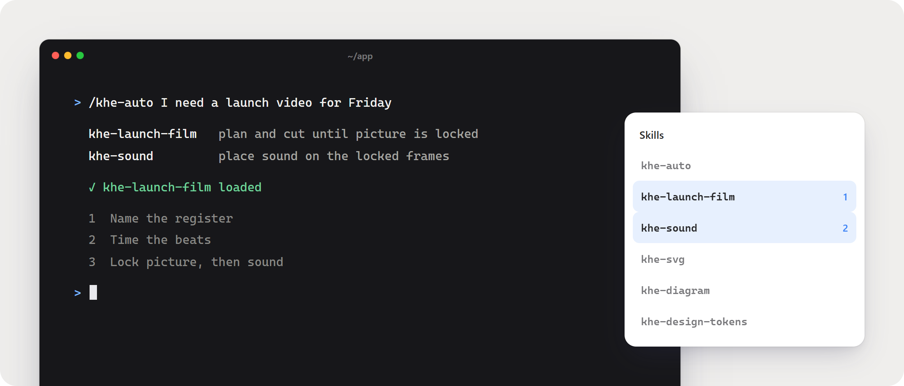

# Skills

Skills I use with coding agents.



```sh
npx skills add HKTITAN/skills
```

## Mine

| Skill | What it does |
|---|---|
| [khe-auto](skills/khe-auto/README.md) | Picks the right skill for a request and runs it. Start here. |
| [khe-design-tokens](skills/khe-design-tokens/README.md) | Finds the project's `.design` file or DESIGN.md and threads its tokens through the UI. |
| [khe-svg](skills/khe-svg/README.md) | Makes, cleans, animates and morphs SVG, or turns a flat clip into an editable vector. |
| [khe-diagram](skills/khe-diagram/README.md) | Decides whether to draw at all, then draws a finished figure or edits a live tldraw canvas. |
| [khe-sound](skills/khe-sound/README.md) | Decides which moments earn a sound or a haptic, makes one family, and places it on the frame. |
| [khe-launch-film](skills/khe-launch-film/README.md) | Plans, cuts and reviews a launch video against 47 films I measured. |

Install one at a time with `--skill`:

```sh
npx skills add HKTITAN/skills --skill khe-auto
```

Each skill includes its own licence. `references/pov.md` and `references/gotchas.md` in every skill are yours to edit.

## From others

Skills by other people that I use next to mine. They are not copied here. Each link goes to the original file in its own repo, and `khe-auto` routes to them by name.

### Benji Taylor

```sh
npx skills add benjitaylor/skills --skill stageshow
```

| Skill | What I use it for |
|---|---|
| [stageshow](https://github.com/benjitaylor/skills/blob/main/stageshow/SKILL.md) | Faux product UI: product shots, cursor demos and bento grids. The image above is made with it. |

### Emil Kowalski

```sh
npx skills add emilkowalski/skills
```

| Skill | What I use it for |
|---|---|
| [emil-design-eng](https://github.com/emilkowalski/skills/blob/main/skills/emil-design-eng/SKILL.md) | General UI craft and reviews. |
| [animate](https://github.com/emilkowalski/skills/blob/main/skills/animate/SKILL.md) | Building one animation with the right ingredients. |
| [review-animations](https://github.com/emilkowalski/skills/blob/main/skills/review-animations/SKILL.md) | A strict review of motion before it merges. |
| [improve-animations](https://github.com/emilkowalski/skills/blob/main/skills/improve-animations/SKILL.md) | Auditing all the motion in a codebase into plans. |
| [find-animation-opportunities](https://github.com/emilkowalski/skills/blob/main/skills/find-animation-opportunities/SKILL.md) | Finding the few places that should move. |
| [remove-animations](https://github.com/emilkowalski/skills/blob/main/skills/remove-animations/SKILL.md) | Removing motion the app does not need. |
| [choreograph](https://github.com/emilkowalski/skills/blob/main/skills/choreograph/SKILL.md) | Several elements moving together. |
| [animation-performance](https://github.com/emilkowalski/skills/blob/main/skills/animation-performance/SKILL.md) | Animations that drop frames. |
| [gestures](https://github.com/emilkowalski/skills/blob/main/skills/gestures/SKILL.md) | Drag, swipe and sheet interactions. |
| [apple-design](https://github.com/emilkowalski/skills/blob/main/skills/apple-design/SKILL.md) | Fluid, physical motion. |
| [animation-vocabulary](https://github.com/emilkowalski/skills/blob/main/skills/animation-vocabulary/SKILL.md) | The exact word for a motion effect. |
| [mobile-native](https://github.com/emilkowalski/skills/blob/main/skills/mobile-native/SKILL.md) | Making a web app feel native on a phone. |
| [break-ui](https://github.com/emilkowalski/skills/blob/main/skills/break-ui/SKILL.md) | Breaking a UI with worst-case data. |
| [prototype](https://github.com/emilkowalski/skills/blob/main/skills/prototype/SKILL.md) | Several versions of a UI behind a picker. |
| [pick-ui-library](https://github.com/emilkowalski/skills/blob/main/skills/pick-ui-library/SKILL.md) | Choosing a library for a frontend task. |
| [animate-expo](https://github.com/emilkowalski/skills/blob/main/skills/animate-expo/SKILL.md) | Motion in React Native and Expo. |
| [ask-sonner](https://github.com/emilkowalski/skills/blob/main/skills/ask-sonner/SKILL.md) | Working with Sonner. |

Both repos are also linked under [`external/`](external) as git submodules, pinned to the commit I last read. `npx skills add HKTITAN/skills` installs only my skills.

## License

[MIT](LICENSE). Other people's skills keep their own licences in their own repos.
