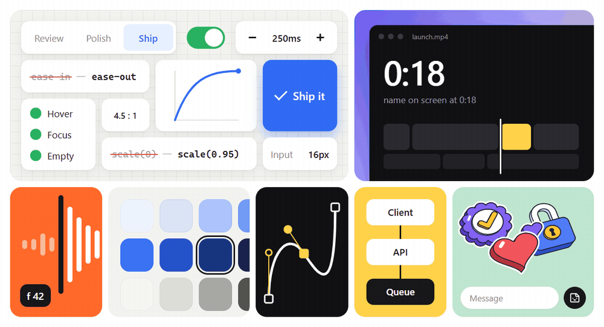

# kheSkills

[](https://skills.sh/HKTITAN/skills)
[](https://github.com/HKTITAN/skills/actions/workflows/ci.yml)
[](LICENSE)

<picture>
  <source media="(prefers-color-scheme: dark)" srcset=".github/assets/kheskills-dark.gif">
  
</picture>

I'm [Harshit Khemani](https://www.khe.money). I've been building products for five years, and these days I build them with coding agents: the interface, the launch film, the demo, the stickers, the posts and the pictures that go in them.

Agents can build a screen that looks right in a screenshot. They cannot tell when it feels right. They reach for a spinner on a 200ms call, pick an easing because it looked familiar, lay a music bed under a logo reveal to hide the sync work, and call it done.

**kheSkills is how I fix that.** These are the skills I run every day. Each one owns a job from the first line to a result I would put my name on, gives numbers instead of adjectives, and says what it could not verify.

```sh
npx skills add HKTITAN/skills
```

## Start here

Type the job. `khe-auto` picks the playbook, runs the skills in order and looks at the result between steps.

```text
/khe-auto I need a launch video for Friday. 30 seconds, product-led.
```

```text
/khe-auto build the settings page. We have a .design file.
```

```text
/khe-auto we ship Thursday. What is broken?
```

It has nine playbooks: [launch film](skills/khe-auto/playbooks/launch-film.md), [logo reveal](skills/khe-auto/playbooks/logo-reveal.md), [landing page](skills/khe-auto/playbooks/landing-page.md), [new screen](skills/khe-auto/playbooks/new-screen.md), [feel better](skills/khe-auto/playbooks/feel-better.md), [sound pass](skills/khe-auto/playbooks/sound-pass.md), [design system](skills/khe-auto/playbooks/design-system.md), [launch week](skills/khe-auto/playbooks/launch-week.md) and [explain a system](skills/khe-auto/playbooks/explain-a-system.md). Each names the skills, the order and the exit check for every step.

If you already know the skill, call it directly.

## Skills

| Skill | Say | What you get |
|---|---|---|
| [khe-auto](skills/khe-auto/README.md) | "auto" | The job done in the right order. It picks the playbook and runs my skills and the ones I use from others. |
| [khe-ui](skills/khe-ui/README.md) | "review this", "make it feel right" | A screen built or judged against exact values across eleven areas, and a review that ends in Blocked, Approve with changes or Ship it. |
| [khe-design-tokens](skills/khe-design-tokens/README.md) | "use our tokens" | Your `.design` file or DESIGN.md threaded through the UI, so the agent stops inventing colors and sizes. |
| [khe-svg](skills/khe-svg/README.md) | "animate this logo" | A clean, token-aware SVG that moves, or a flat clip turned into one editable vector file. |
| [khe-sticker](skills/khe-sticker/README.md) | "make a sticker pack" | Any kind of sticker, built to pop once and hold still, and a pack in the formats WhatsApp and Telegram take. |
| [khe-diagram](skills/khe-diagram/README.md) | "diagram this" | A figure that reads as designed, a live tldraw board, or an honest "this does not need a diagram". |
| [khe-sound](skills/khe-sound/README.md) | "add sound" | One family of sounds, generated, wired, and placed on the exact frame the motion lands. Most moments get none. |
| [khe-launch-film](skills/khe-launch-film/README.md) | "launch film" | A launch video planned beat by beat and reviewed against 47 films I measured frame by frame. |
| [khe-demo](skills/khe-demo/README.md) | "record a demo" | The real app, driven through one planned flow on seeded data and recorded as a clean take: a video and a GIF. |
| [khe-brain-emil](skills/khe-brain-emil/README.md) | "what would Emil say" | An answer from Emil Kowalski's public writing with the article named, and a plain "he has not written about this" when he has not. |
| [khe-brain-benji](skills/khe-brain-benji/README.md) | "would Benji ship this" | An answer from Benji Taylor's public writing and skills with the source named, and a design pressure-tested against it. |
| [khe-brain-varun](skills/khe-brain-varun/README.md) | "what would Varun say" | An answer from 18 of Varun Mayya's public videos with the video and the minute named, and a plan pressure-tested against it. |
| [khe-brain-enrico](skills/khe-brain-enrico/README.md) | "what would Enrico say" | An answer from all 88 long videos on Enrico Tartarotti's YouTube channel with the video and the minute named, and a design or a product plan pressure-tested against it. |
| [khe-brain-isb](skills/khe-brain-isb/README.md) | "what do the ISB notes say" | An answer from the public isb-skills notes with the file named, benchmarks marked as unsourced, and a plan pressure-tested against it. |
| [khe-brain-harshit](skills/khe-brain-harshit/README.md) | "write a khe.money post in Harshit's voice" | A brain of Harshit Khemani: an answer from every post he made on X and LinkedIn with the post named, and a draft in his current voice that rests only on views he has posted. |
| [khe-brain-yc](skills/khe-brain-yc/README.md) | "what does YC say about" | An answer from 88 Y Combinator essays, posts and talks with the partner who said it named and the piece linked, and a plan pressure-tested against them. |
| [khe-poteto-pyramid](skills/khe-poteto-pyramid/README.md) | "the agent keeps doing this" | The correction moved to where the next agent cannot make the mistake: the code, a check whose error names the fix, or verification, proved on the past mistake, with the AGENTS.md line it replaces deleted. |
| [khe-package](skills/khe-package/README.md) | "package this", "make a video of this for X" | Three ideas as stills, then a video rendered frame by frame at 60 fps, sharp on a phone, with your system's real cursor, and a first line written for a stranger. |
| [khe-content-engine](skills/khe-content-engine/README.md) | "build me a content engine" | Your voice, audience and platforms written down once, then one idea turned into a different draft for each platform. You post them. |

Install one at a time with `--skill`:

```sh
npx skills add HKTITAN/skills --skill khe-ui
```

<!-- install:start -->
In Claude Code they install as plugins from one marketplace. Add it with `--sparse`, exactly as below: the linked skills are git submodules beside mine, and without it Claude Code downloads all of them and the add times out.

```text
/plugin marketplace add HKTITAN/skills --sparse .claude-plugin agents skills/khe-auto skills/khe-brain-benji skills/khe-brain-emil skills/khe-brain-enrico skills/khe-brain-harshit skills/khe-brain-isb skills/khe-brain-varun skills/khe-brain-yc skills/khe-content-engine skills/khe-demo skills/khe-design-tokens skills/khe-diagram skills/khe-launch-film skills/khe-package skills/khe-poteto-pyramid skills/khe-sound skills/khe-sticker skills/khe-svg skills/khe-ui
/plugin install kheskills@kheskills
/plugin install khe-brain@kheskills
```

`kheskills` is every skill above except the brains, plus the four kheAgents; `khe-brain` is the brains. The skills are then `/kheskills:khe-ui`, `/kheskills:khe-auto` and so on.

For a team, put the same in the project's `.claude/settings.json`, so everyone who trusts the folder gets the marketplace without typing the list:

```json
{
  "extraKnownMarketplaces": {
    "kheskills": {
      "source": { "source": "github", "repo": "HKTITAN/skills", "sparsePaths": [".claude-plugin","agents","skills/khe-auto","skills/khe-brain-benji","skills/khe-brain-emil","skills/khe-brain-enrico","skills/khe-brain-harshit","skills/khe-brain-isb","skills/khe-brain-varun","skills/khe-brain-yc","skills/khe-content-engine","skills/khe-demo","skills/khe-design-tokens","skills/khe-diagram","skills/khe-launch-film","skills/khe-package","skills/khe-poteto-pyramid","skills/khe-sound","skills/khe-sticker","skills/khe-svg","skills/khe-ui"] }
    }
  }
}
```

The same marketplace serves the skills I use from other people, each straight from its author's repo:

```text
/plugin install benji-taylor@kheskills
/plugin install emil-kowalski@kheskills
/plugin install matt-pocock@kheskills
/plugin install pasquale-vitiello@kheskills
/plugin install pstack@kheskills
/plugin install vercel@kheskills
/plugin install vercel-ui-sdk@kheskills
```

`pstack` here is the Claude Code build of Lauren Tan's Cursor plugin, so its skills are `/pstack:<name>`. `matt-pocock` is Matt Pocock's own plugin, as his manifest defines it. The others serve exactly the skills listed under From others below.

If an add or update still times out on a slow connection, raise Claude Code's clone timeout (milliseconds) and run it again: `CLAUDE_CODE_PLUGIN_GIT_TIMEOUT_MS=300000`.
<!-- install:end -->

Then `/khe-brain:emil-kowalski`, `/khe-brain:benji-taylor`, `/khe-brain:varun-mayya`, `/khe-brain:isb`, `/khe-brain:yc`, `/khe-brain:harshitkhemani` and `/khe-brain:enrico-tartarotti` each take a question. The plugin reads the same skill folders, so the answers are the same either way.

Agents that load the [Agent Plugins](https://agent-plugins.org) standard read [`plugin.json`](plugin.json) at the root: the repo is one plugin, `kheskills`, holding every khe skill, brains included. That standard has no agents or commands yet, so the kheAgents and the `/khe-brain:` commands are Claude Code only.

Each skill works alone. Some call others:


- `khe-auto` uses all of them.
- `khe-ui` hands to `khe-design-tokens` first when the project has a contract.
- `khe-ui` takes over from Vercel's `ui-sdk` on a project built with UI SDK: that skill composes the components, mine decides what they look like and whether they are finished.
- `khe-launch-film` hands to `khe-sound` once picture is locked.
- `khe-svg` hands to `khe-sound` when a reveal should make a sound.
- `khe-demo` hands its take to `khe-launch-film` when the recording is one shot in a film.
- `khe-package` renders a `stageshow` scene when there is no live build to point at, and hands the post to `khe-content-engine`.
- `khe-auto` places every correction made during a job with `khe-poteto-pyramid`, so the next agent inherits the fix.
- `khe-poteto-pyramid` hands the deep parts to Lauren Tan's pstack skills by name: verification skills, formal models, statecharts, comment sweeps.

## kheAgents and orchestration

The `kheskills` plugin also installs four agents for orchestrated work, as `kheskills:<name>`:

| Agent | Does |
|---|---|
| [khe-router](agents/khe-router.md) | Routes one request through `khe-auto` and returns only the route. Read-only |
| [khe-executor](agents/khe-executor.md) | Executes one build, test or check step by the skill that owns it, runs its gate, returns evidence |
| [khe-reviewer](agents/khe-reviewer.md) | A fresh-eye review of an executor's result: runs the gate itself, ranks findings, gives a verdict |
| [khe-pyramid](agents/khe-pyramid.md) | Places one correction with `khe-poteto-pyramid` into `PYRAMID.md` |

[`orchestration/CLAUDE.md`](orchestration/CLAUDE.md) is the policy that uses them: the top session routes and orchestrates, one sub-session per task on a model picked for that task (none is hardcoded), executors do the work, every "done" carries its evidence, and every correction is placed. Paste it into your own `~/.claude/CLAUDE.md`; a plugin cannot install a CLAUDE.md for you.

## What is in a skill

```text
skills/khe-ui/
  SKILL.md        what the agent reads: what it owns, the hard rules, the steps
  README.md       the page for people: what it does, a before and after, example prompts
  references/     the detail, opened one file at a time
  examples/       finished work that sets the bar, and the place to start from
  teaching/       the same thing done wrong and right, one fault each
  scripts/        the gate: it names every fault it can prove and ends "passed"
  LICENSE
```

The agent reads `SKILL.md` and opens a reference only when the job needs it, so a deep skill costs nothing until it is used.

## Cheatsheets

One table each: the problem as you would say it, and the value that fixes it.

[UI](cheatsheets/ui.md) · [Motion](cheatsheets/motion.md) · [SVG](cheatsheets/svg.md) · [Sticker](cheatsheets/sticker.md) · [Sound](cheatsheets/sound.md) · [Launch film](cheatsheets/film.md) · [Demo](cheatsheets/demo.md) · [Diagram](cheatsheets/diagram.md) · [Tokens](cheatsheets/tokens.md) · [Package](cheatsheets/package.md) · [Pyramid](cheatsheets/pyramid.md)

## From others

Skills by other people that I use next to mine. They are not copied here. Emil's, Benji's, Pasquale Vitiello's, Vercel's, Lauren Tan's and Matt Pocock's are linked in [`skills/`](skills) as git submodules that follow their repos automatically. Each link below goes to the original file, and `khe-auto` routes to all of them by name.

### Benji Taylor

```sh
npx skills add benjitaylor/skills --skill stageshow
```

| Skill | What I use it for |
|---|---|
| [stageshow](https://github.com/benjitaylor/skills/blob/main/stageshow/SKILL.md) | Faux product UI: product shots, cursor demos and bento grids. The image above is made with it. |

### Pasquale Vitiello

```sh
npx skills add pasqualevitiello/plotter --skill plotter
```

| Skill | What I use it for |
|---|---|
| [plotter](https://github.com/pasqualevitiello/plotter/blob/main/skills/plotter/SKILL.md) | Blueprint line illustrations as editable SVG, each built on one construction relationship: heroes, spot and empty-state drawings, docs. The [catalogue](https://plotter.pasqualevitiello.com/) shows the grammar. |

### Emil Kowalski

```sh
npx skills add emilkowalski/skills
```

| Skill | What I use it for |
|---|---|
| [emil-design-eng](https://github.com/emilkowalski/skills/blob/main/skills/emil-design-eng/SKILL.md) | General UI craft and reviews. |
| [animate](https://github.com/emilkowalski/skills/blob/main/skills/animate/SKILL.md) | Building one animation with the right ingredients. |
| [review-animations](https://github.com/emilkowalski/skills/blob/main/skills/review-animations/SKILL.md) | A strict review of motion before it merges. |
| [improve-animations](https://github.com/emilkowalski/skills/blob/main/skills/improve-animations/SKILL.md) | Auditing all the motion in a codebase into plans. |
| [find-animation-opportunities](https://github.com/emilkowalski/skills/blob/main/skills/find-animation-opportunities/SKILL.md) | Finding the few places that should move. |
| [remove-animations](https://github.com/emilkowalski/skills/blob/main/skills/remove-animations/SKILL.md) | Removing motion the app does not need. |
| [choreograph](https://github.com/emilkowalski/skills/blob/main/skills/choreograph/SKILL.md) | Several elements moving together. |
| [animation-performance](https://github.com/emilkowalski/skills/blob/main/skills/animation-performance/SKILL.md) | Animations that drop frames. |
| [gestures](https://github.com/emilkowalski/skills/blob/main/skills/gestures/SKILL.md) | Drag, swipe and sheet interactions. |
| [apple-design](https://github.com/emilkowalski/skills/blob/main/skills/apple-design/SKILL.md) | Fluid, physical motion. |
| [animation-vocabulary](https://github.com/emilkowalski/skills/blob/main/skills/animation-vocabulary/SKILL.md) | The exact word for a motion effect. |
| [mobile-native](https://github.com/emilkowalski/skills/blob/main/skills/mobile-native/SKILL.md) | Making a web app feel native on a phone. |
| [break-ui](https://github.com/emilkowalski/skills/blob/main/skills/break-ui/SKILL.md) | Breaking a UI with worst-case data. |
| [learn-taste](https://github.com/emilkowalski/skills/blob/main/skills/learn-taste/SKILL.md) | Turning a session's design corrections into written rules. |
| [prototype](https://github.com/emilkowalski/skills/blob/main/skills/prototype/SKILL.md) | Several versions of a UI behind a picker. |
| [pick-ui-library](https://github.com/emilkowalski/skills/blob/main/skills/pick-ui-library/SKILL.md) | Choosing a library for a frontend task. |
| [animate-expo](https://github.com/emilkowalski/skills/blob/main/skills/animate-expo/SKILL.md) | Motion in React Native and Expo. |
| [ask-sonner](https://github.com/emilkowalski/skills/blob/main/skills/ask-sonner/SKILL.md) | Working with Sonner. |
| [write-swift](https://github.com/emilkowalski/skills/blob/main/skills/write-swift/SKILL.md) | Writing modern Swift. |

### Vercel

```sh
npx skills add vercel-labs/ui --skill ui-sdk
npx skills add vercel-labs/agent-skills
```

| Skill | What I use it for |
|---|---|
| [ui-sdk](https://github.com/vercel-labs/ui/blob/main/packages/core/skills/ui-sdk/SKILL.md) | Building on [UI SDK](https://ui-sdk.dev): choosing and composing its components, building one it does not ship from the behaviors in `@ui-sdk/core`, making the page usable by an agent, and testing keyboard, focus and ARIA. `khe-ui` then styles and judges what it rendered. |
| [web-design-guidelines](https://github.com/vercel-labs/agent-skills/blob/main/skills/web-design-guidelines/SKILL.md) | Checking UI code against Vercel's Web Interface Guidelines. |
| [vercel-react-view-transitions](https://github.com/vercel-labs/agent-skills/blob/main/skills/react-view-transitions/SKILL.md) | React's View Transition API. |
| [vercel-react-best-practices](https://github.com/vercel-labs/agent-skills/blob/main/skills/react-best-practices/SKILL.md) | React and Next.js performance rules. |
| [vercel-composition-patterns](https://github.com/vercel-labs/agent-skills/blob/main/skills/composition-patterns/SKILL.md) | Composing React components. |
| [vercel-react-native-skills](https://github.com/vercel-labs/agent-skills/blob/main/skills/react-native-skills/SKILL.md) | React Native and Expo performance. |
| [deploy-to-vercel](https://github.com/vercel-labs/agent-skills/blob/main/skills/deploy-to-vercel/SKILL.md) | Deploying to Vercel. |
| [vercel-cli-with-tokens](https://github.com/vercel-labs/agent-skills/blob/main/skills/vercel-cli-with-tokens/SKILL.md) | The Vercel CLI with a token. |
| [vercel-optimize](https://github.com/vercel-labs/agent-skills/blob/main/skills/vercel-optimize/SKILL.md) | Cost and performance on a deployed Vercel project. |
| [writing-guidelines](https://github.com/vercel-labs/agent-skills/blob/main/skills/writing-guidelines/SKILL.md) | Checking docs against Vercel's Writing Guidelines. |
| [ui-sdk-write-code](https://github.com/vercel-labs/ui/blob/main/.agents/skills/ui-sdk-write-code/SKILL.md) | Writing code inside the UI SDK repository. |
| [ui-sdk-expert-review](https://github.com/vercel-labs/ui/blob/main/.agents/skills/ui-sdk-expert-review/SKILL.md) | Reviewing a change to the UI SDK repository. |
| [ui-sdk-unslop](https://github.com/vercel-labs/ui/blob/main/.agents/skills/ui-sdk-unslop/SKILL.md) | Cleaning a diff in the UI SDK repository. |
| [ui-sdk-write-docs](https://github.com/vercel-labs/ui/blob/main/.agents/skills/ui-sdk-write-docs/SKILL.md) | Writing docs for the UI SDK site. |

All fourteen are pinned in `skills/` like the others: nine from [vercel-labs/agent-skills](https://github.com/vercel-labs/agent-skills) and five from [vercel-labs/ui](https://github.com/vercel-labs/ui). The four `ui-sdk-*` skills are that repository's own contributor skills, from its `.agents/skills` folder, and are useful only for work inside it. `ui-sdk` is the one to install for building with the library. The skill lives inside the UI SDK monorepo, at `packages/core/skills/ui-sdk`, so the pin follows the whole library and moves whenever the library does. The copy that matches your project ships with the package, at `node_modules/@ui-sdk/core/skills/ui-sdk/SKILL.md`. UI SDK is in beta.

`npx skills add HKTITAN/skills` installs only my skills. Install theirs from their repos with the commands above.

### Lauren Tan (poteto)

Her pstack skills, the source of the pyramid in `khe-poteto-pyramid`. pstack is written for Cursor; the links below go to the Claude Code build Cursor generates from it, which reads a short adapter that maps Cursor's names (subagent types, custom modes, bugbot, automations) onto Claude Code. The skills lean on each other and on her principles, so install the whole plugin. In Claude Code:

```text
/plugin marketplace add cursor/plugins
/plugin install pstack@cursor-plugins
```

Then each skill is `/pstack:<name>`: `/pstack:poteto-mode`, `/pstack:correct`. In Cursor it is `/add-plugin pstack` and the names have no prefix.

| Skill | What I use it for |
|---|---|
| [poteto-mode](https://github.com/cursor/plugins/blob/main/harness/pstack/claude-code/skills/poteto-mode/SKILL.md) | Her whole workflow for any non-trivial task. It routes to her playbooks and principles. |
| [poteto-help](https://github.com/cursor/plugins/blob/main/harness/pstack/claude-code/skills/poteto-help/SKILL.md) | Finding which of her skills or playbooks fits. |
| [correct](https://github.com/cursor/plugins/blob/main/harness/pstack/claude-code/skills/correct/SKILL.md) | Her own sweep for the mistakes agents repeat, fixed at the highest level that works. |
| [no-comments](https://github.com/cursor/plugins/blob/main/harness/pstack/claude-code/skills/no-comments/SKILL.md) | Stripping comments from a diff and encoding the constraints they claim. |
| [create-verification-skill](https://github.com/cursor/plugins/blob/main/harness/pstack/claude-code/skills/create-verification-skill/SKILL.md) | A project skill that launches, drives and records the real app, with a feature map. |
| [maintain-verification-skill](https://github.com/cursor/plugins/blob/main/harness/pstack/claude-code/skills/maintain-verification-skill/SKILL.md) | Keeping that feature map in line with the app. |
| [create-formal-verification-skill](https://github.com/cursor/plugins/blob/main/harness/pstack/claude-code/skills/create-formal-verification-skill/SKILL.md) | Checking a race, retry or state machine formally and keeping it checked. |
| [maintain-formal-verification-skill](https://github.com/cursor/plugins/blob/main/harness/pstack/claude-code/skills/maintain-formal-verification-skill/SKILL.md) | Updating a formal model after the code changed. |
| [statechart](https://github.com/cursor/plugins/blob/main/harness/pstack/claude-code/skills/statechart/SKILL.md) | A behavior drawn as a statechart from a checked TLA+ model. |
| [how](https://github.com/cursor/plugins/blob/main/harness/pstack/claude-code/skills/how/SKILL.md) | How a subsystem works at runtime. |
| [why](https://github.com/cursor/plugins/blob/main/harness/pstack/claude-code/skills/why/SKILL.md) | Why something was built this way, from the record. |
| [recall](https://github.com/cursor/plugins/blob/main/harness/pstack/claude-code/skills/recall/SKILL.md) | Rebuilding recent context from chat history. |
| [teach](https://github.com/cursor/plugins/blob/main/harness/pstack/claude-code/skills/teach/SKILL.md) | Understanding a change, diagram by diagram. |
| [architect](https://github.com/cursor/plugins/blob/main/harness/pstack/claude-code/skills/architect/SKILL.md) | Settling usage, types and module shape before writing code across a boundary. |
| [arena](https://github.com/cursor/plugins/blob/main/harness/pstack/claude-code/skills/arena/SKILL.md) | Several parallel attempts, then the best parts of each. |
| [swarm](https://github.com/cursor/plugins/blob/main/harness/pstack/claude-code/skills/swarm/SKILL.md) | Many parallel workers, one report. |
| [interrogate](https://github.com/cursor/plugins/blob/main/harness/pstack/claude-code/skills/interrogate/SKILL.md) | Other models trying to break a diff, keeping only proven findings. |
| [blast-radius](https://github.com/cursor/plugins/blob/main/harness/pstack/claude-code/skills/blast-radius/SKILL.md) | What else a small change could break. |
| [tdd](https://github.com/cursor/plugins/blob/main/harness/pstack/claude-code/skills/tdd/SKILL.md) | A bug fixed test-first when the test path is cheap. |
| [benchmark-checklist](https://github.com/cursor/plugins/blob/main/harness/pstack/claude-code/skills/benchmark-checklist/SKILL.md) | Vetting a measured number before reporting it. |
| [technical-writing](https://github.com/cursor/plugins/blob/main/harness/pstack/claude-code/skills/technical-writing/SKILL.md) | Docs, READMEs, PR descriptions and commit messages. |

These 21 are pinned in `skills/` from [cursor/plugins](https://github.com/cursor/plugins), whose Claude Code build lives at [harness/pstack/claude-code](https://github.com/cursor/plugins/tree/main/harness/pstack/claude-code). Her other skills (the 24 principles, the catch-up and bot-UI skills, setup) come with the plugin and are not linked here. The plugin lives in Cursor's plugin monorepo, so the pin moves whenever that repo does.

### Matt Pocock

```sh
npx skills add mattpocock/skills
```

| Skill | What I use it for |
|---|---|
| [codebase-design](https://github.com/mattpocock/skills/blob/main/skills/engineering/codebase-design/SKILL.md) | Deep modules: interfaces, seams and adapters. |
| [improve-codebase-architecture](https://github.com/mattpocock/skills/blob/main/skills/engineering/improve-codebase-architecture/SKILL.md) | Finding the shallow modules worth deepening. |
| [diagnosing-bugs](https://github.com/mattpocock/skills/blob/main/skills/engineering/diagnosing-bugs/SKILL.md) | A diagnosis loop for hard bugs and regressions. |
| [domain-modeling](https://github.com/mattpocock/skills/blob/main/skills/engineering/domain-modeling/SKILL.md) | A project's glossary and ADRs. |
| [grill-with-docs](https://github.com/mattpocock/skills/blob/main/skills/engineering/grill-with-docs/SKILL.md) | An interview that sharpens a plan and writes the docs as it goes. |
| [grill-me](https://github.com/mattpocock/skills/blob/main/skills/productivity/grill-me/SKILL.md) | An interview that sharpens a plan. |
| [pocock-code-review](https://github.com/mattpocock/skills/blob/main/skills/engineering/code-review/SKILL.md) | A branch reviewed against the repo's standards and its spec. Named `code-review` in his repo. |
| [setup-pre-commit](https://github.com/mattpocock/skills/blob/main/skills/misc/setup-pre-commit/SKILL.md) | Pre-commit hooks that format, type-check and test. |
| [git-guardrails-claude-code](https://github.com/mattpocock/skills/blob/main/skills/misc/git-guardrails-claude-code/SKILL.md) | Hooks that block destructive git commands. |
| [to-spec](https://github.com/mattpocock/skills/blob/main/skills/engineering/to-spec/SKILL.md) | The conversation turned into a spec on the tracker. |
| [wayfinder](https://github.com/mattpocock/skills/blob/main/skills/engineering/wayfinder/SKILL.md) | Work bigger than one session, as decision tickets. |
| [handoff](https://github.com/mattpocock/skills/blob/main/skills/productivity/handoff/SKILL.md) | A handoff document for the next agent. |
| [pocock-tdd](https://github.com/mattpocock/skills/blob/main/skills/engineering/tdd/SKILL.md) | Red, green, refactor. Named `tdd` in his repo. |

These 13 are pinned in `skills/` from [mattpocock/skills](https://github.com/mattpocock/skills). Two take a `pocock-` prefix here because Emil's `prototype` and Lauren's `tdd` already use the short names; the links go to the originals.

## khe, my design system

[khe](https://github.com/HKTITAN/khe) is how my own things look, read and move: one set of colours, type, springs and parts for [khe.money](https://www.khe.money), papers and decks. The brand page is [ds.khe.money](https://ds.khe.money).

It ships as a contract, not a skill: [`khe.DESIGN`](https://raw.githubusercontent.com/HKTITAN/khe/main/khe.DESIGN) (schema design.v1) is built from its tokens, so it never drifts. `khe-design-tokens` reads it like any other `.design` file. To make something in khe, point your agent at it:

```text
Read https://raw.githubusercontent.com/HKTITAN/khe/main/khe.DESIGN and follow its agent.instructions.
```

## Make them yours

These are starting points. Every skill has two files that are yours to edit, and both outrank the skill's defaults:

- `references/pov.md`: your taste calls. "I always prefer X over Y."
- `references/gotchas.md`: one line each time the agent gets a detail wrong. Append only.

A project's `.design` file or DESIGN.md outranks both. Fork it, change it, make it yours.

Writing your own? [CONTRIBUTING.md](CONTRIBUTING.md) is how these are written, and how to tell whether something should be a skill at all.

## License

[MIT](LICENSE). Other people's skills keep their own licences in their own repos.
