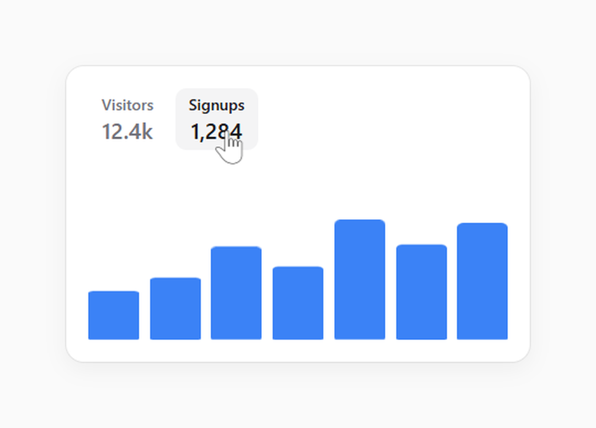

# khe-package

Turns something you built into a video a stranger stops for, and a first line that tells them why. Three ideas as stills first, then a render one frame at a time at 60 fps, sharp on a phone, with your system's real cursor.

```bash
npx skills add HKTITAN/skills --skill khe-package
```

## What it does

- Picks the format from what you are showing: an explainer rendered from an HTML page, a click-through of one live component, a hover reel, a Stageshow product shot, or a page you record yourself.
- Sends three different ideas as stills before any render, then two to four stills of the one you pick. Rendering takes minutes; agreeing on stills takes seconds.
- Renders frame by frame on a paused clock: timers, animation frames, CSS transitions and WAAPI animations all step together, so nothing drops or stutters. It never records in real time.
- Crops to the work with 40 to 60 px of page around it and sets the device scale so the short side is at least 2000 px and the long side at most 4096.
- Draws your operating system's own cursor on a slight curve, starting and ending off-frame, and holds it still while the animation plays.
- Times it to the format: first action 0.3 to 0.4 s in, hard cuts, 6 to 9 s for a click-through, 20 to 26 s for an explainer.
- Writes the post's first line for a stranger and hands the rest to `khe-content-engine`. A person posts.

## How it runs


## Used



```text
/khe-package make a video of the metrics card for X
```

Three ideas came back as stills; A (switch the tabs three times, bars regrowing) was picked. The render: `out/metrics-7s.mp4`, 2970 by 2134, 60 fps, 7 s, from `examples/live/shot.json`. First line: "Bars that regrow from the baseline read as new data, not a redraw. The whole trick is one transform-origin:"

## When to use it

Use it when you built something and want people to see it: a component, an interaction, a design, a small tool. For a whole product flow recorded from seeded state use `khe-demo`; for a film with titles, cuts and sound `khe-launch-film`; for the posts on each platform `khe-content-engine`; for faux product UI built from scratch `stageshow` (Benji Taylor), which this skill can then render.

## Invoke with

`/khe-package [what] [for X | newsletter | launch post] [ideas | stills | render]`

Or in your own words: "package this", "make a 4k video of the onboarding flow for the launch post", "give me three ideas for the announcement video".

## Example prompts

- Package the new date picker for X. Ideas first.
- Make an explainer of why our menus open with ease-out, 1:1, about 20 seconds.
- Render the pricing cards as a hover reel.
- We have no live build yet. Package the dashboard as a Stageshow shot.

## Verify

```bash
node scripts/render.mjs live examples/live/shot.json stills 0.4,1.2,1.7 --playwright <a project with playwright-core>
node scripts/package-check.mjs PACKAGE.md --video out/name-7s.mp4 --gate
node scripts/package-check.mjs --self-test
```

What the gate proves: the format is named, three ideas came before the render, the look was approved on stills, nothing was captured in real time, the frame is 2000 px or more on the short side and 4096 or less on the long, 60 fps, the margin and length fit the format, the cursor is not drawn, the first line is not about the maker, and with `--video` that the file matches the plan. What it cannot see: whether the first second reads, whether the cursor covers a word, or whether the post is any good. Look at the frames.

## What is inside

```text
SKILL.md        the jobs, the hard rules, the steps
references/     formats, framing, timing, cursor, render, plan, post, verify, review, sources
examples/       four gold plans, an explainer page, a live stage and its shot list
teaching/       eleven bad and good pairs, one fault each
scripts/        render.mjs (stills and video on a paused clock), package-check.mjs (the gate)
```

## Credit

The approach is Emil Kowalski's way of packaging work, rewritten in this collection's format with a renderer and gate built fresh. Not written or endorsed by him.

Harshit Khemani. MIT.
